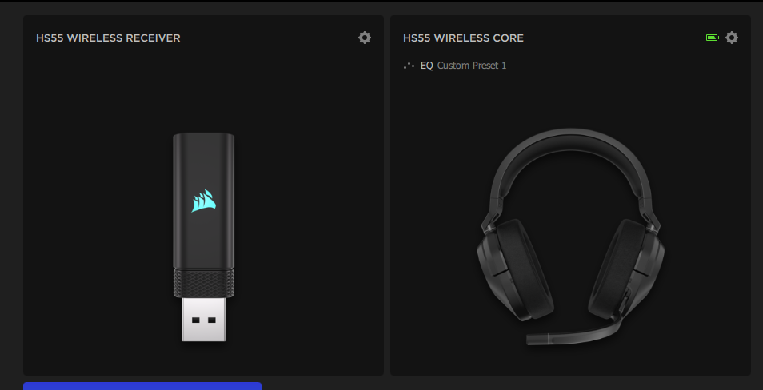
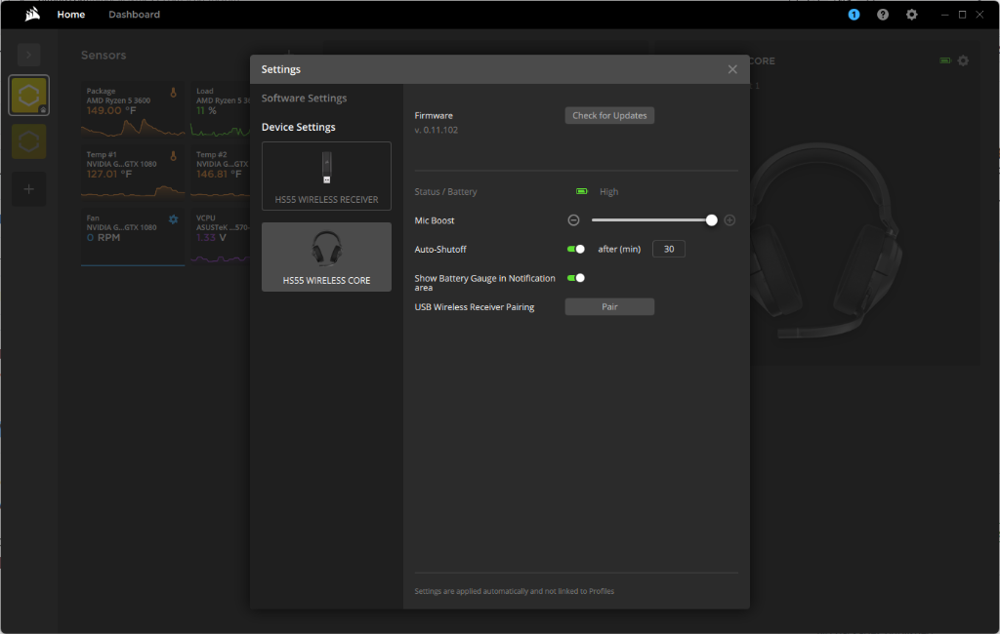
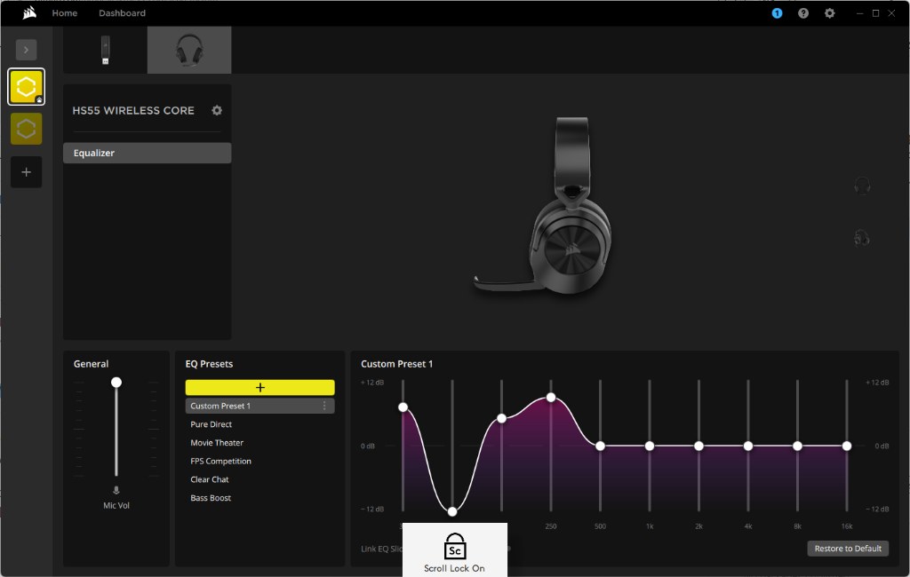

# Corsair HS55 WIRELESS CORE — iCUE Feature Restore

Restores the settings the HS55 WIRELESS CORE is missing in Corsair iCUE, and lets a Core headset pair with a standard HS55 WIRELESS receiver.

The Core and the standard HS55 WIRELESS are the same hardware (headset RDA0045, receiver RDA0046, identical FCC IDs). The Core's iCUE device module simply leaves the settings out. The script edits the installed iCUE device modules so iCUE offers them anyway — every restored feature worked in testing because the Core's firmware already supports it.

## Screenshots

| Core headset paired to a standard receiver | Restored Device Settings | Equalizer + Mic Vol |
|---|---|---|
|  |  |  |

## What it restores

- Pairing an HS55 WIRELESS CORE headset to a standard HS55 WIRELESS receiver (USB ID `1B1C:0A8F`) — useful if your headset was sold without its receiver
- Equalizer tab: built-in presets plus custom 10-band presets
- Mic volume slider, mic mute toggle and Mic Boost
- Auto-Shutoff toggle and timeout (stored in the headset, survives across Bluetooth)
- Battery status in Device Settings and a battery gauge in the Windows tray
- Firmware updates through iCUE (tested 0.6.59 → 0.11.102 over the standard receiver)

## What it does not restore

- **Sidetone** — the control can be displayed, but the Core firmware ignores it
- Dolby surround, NVIDIA Broadcast — not enabled (Broadcast also requires an RTX card)

## Requirements

- Windows, Corsair iCUE 5.x (tested on 5.54.46)
- The standard HS55 WIRELESS + RECEIVER modules installed in iCUE, if you want the receiver pairing (the script tells you if they're missing)
- Admin rights to write to `Program Files`; quit iCUE before running

## Usage

```powershell
# from an elevated or normal PowerShell prompt in this folder
.\Patch-HS55Core.ps1            # apply the patch
.\Patch-HS55Core.ps1 -Status    # show installed/patched state only
.\Patch-HS55Core.ps1 -Restore   # put Corsair's original modules back
.\Patch-HS55Core.ps1 -NoReceiverPatch     # only restore Core settings - use this if you own a genuine Core receiver (1B1C:0A95)
.\Patch-HS55Core.ps1 -DevicesDir <path>   # patch a different copy of the devices folder (no elevation, for testing)
```

Backups of the original modules go to `%LOCALAPPDATA%\Corsair\hs55_patch_backup\stock` before anything is changed (or a `patch-backup` subfolder when using `-DevicesDir`). The script is safe to re-run: edits that are already applied are skipped.

## Caveats

- **Unsupported.** This edits Corsair's files. An iCUE update or repair can overwrite them — re-run the script and check `-Status` afterwards. If an update ships a newer module, patch that fresh copy rather than reusing old output.
- While the receiver patch is applied, a *regular* HS55 WIRELESS headset is not recognised on that receiver.
- The Core module normally needs its own receiver (USB ID `1B1C:0A95`). If you own one, the receiver patch is unnecessary — the Core settings should be the only change needed. Untested.
- In user testing the microphone sounded clearer over Bluetooth than over the standard receiver's RF link. Your mileage may vary.
- Works entirely locally; nothing is downloaded or sent anywhere.

## Credits

Discovered and implemented with Devin (Cognition). Community: thanks for testing.
